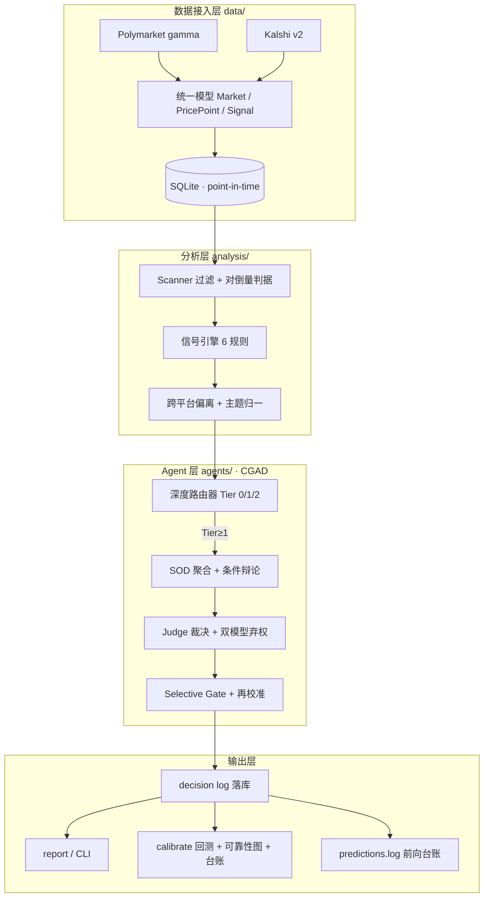

# 设计文档

prediction-market-radar 的完整设计说明。`README.md` 只保留概览；本文档覆盖 CLI、
数据模型、架构、信号规则、消融结果、文献核实与已知边界。

回到 [README](../README.md)。

## CLI

| 命令 | 功能 |
|---|---|
| `scan` | 市场榜单 + 信号表（快路径，含 `suspected_wash` 标记） |
| `run` | 全流程 → Markdown 日报 + 追加预测台账（数据拉取 → 过滤 → 信号 → CGAD 裁决 → 落库） |
| `history <market_id>` | 概率曲线 ASCII 文本图 |
| `calibrate` | Brier / log-loss 回测 + selective 阈值重扫 + 再校准分组 + 可靠性图 + 记忆注入仪表 + 台账关联（事前 Brier） |
| `backfill` | 拉已裁决市场+K线 → 重放信号 → 裁决 → 落库 → 生成分层 Brier（`ablation.md`） |
| `verify <decision_id>` | 回看裁决输入快照（point-in-time） |

全局参数：`--mock`、`--db PATH`、`--verbose`，以及所有 config 阈值（见「假设阈值表」），
例如 `--min-volume-24h 100000 --top-n 10`。所有标注【假设】的值都是可调 CLI 参数。
本批次新增：`--aggregation-method sod|trimmed`、`--second-model`、
`--dual-model-abstain-pp`、`--ledger-path`、`--ledger-source demo|prod`、
`--research-enabled true|false`、`--research-news-limit`、`--research-history-cap`、
`--search-api-url`（`SEARCH_API_KEY` 走环境变量，不落 CLI）。双模型锚点可用
`SECOND_LLM_MODEL` / `SECOND_LLM_BASE_URL` / `SECOND_LLM_API_KEY` 指向独立
provider（默认复用主模型 endpoint/key，与主模型相同时自动禁用）。

## 仓库结构

```
data/        models.py · config.py · http.py · limiter.py · polymarket_client.py
             kalshi_client.py · store.py · mock_data.py · probe.py · ledger.py · news.py
analysis/    scanner.py · signals.py · divergence.py · themes.py
agents/      router.py · prompts.py · llm.py · aggregate.py · debate.py
             judge.py · reflector.py · calibrate.py · research.py
report/      render.py
examples/    sample_output.md · ablation.md · reliability.md
tests/       （离线合成测试 + fixtures/）
main.py      scan / run / history / calibrate / backfill / verify
predictions.log   前向预测台账（append-only hash 链，随仓库公开）
```

## 数据结构

统一模型（`data/models.py`）：`Market` / `PricePoint` / `Signal` / `SampleOutput`
/ `Decision` / `GroundTruth` / `Lesson` / `Evidence`（quote+source+asof_ts+时效分级）。
所有落库行携带 `asof_ts`；`Decision`
存输入快照 hash（`snapshot_hash`）+ 原始采样输出（含 `reasoning` 论据文本），供
消融与回测重放。本批次 `Decision` 新增 `lessons_injected`（注入该裁决的 lesson id
列表）、`dual_model` / `dual_p_yes`（双模型锚点）三字段。

### 两平台字段映射与归一化

| 统一模型 | Polymarket gamma | Kalshi v2 |
|---|---|---|
| `market_id` | `id` | `ticker` |
| `question` | `question` | `event.title + yes_sub_title` |
| `yes_price` | `float(outcomePrices[0])` | `float(yes_bid_dollars)` |
| `volume_24h` | `float(volume 或 volumeNum)` | `float(volume_24h_fp)` |
| `spread` | `bestAsk − bestBid`（列表项无 spread 字段） | `float(yes_ask_dollars) − float(yes_bid_dollars)` |
| `depth` | `float(liquidity 或 liquidityNum)` | `float(liquidity_dollars)` |
| `close_time` | `endDate` | `close_time` |
| `group_key` | `groupItemTitle` | `event_ticker` |

**归一化重点**：两平台的概率表示法不同，统一到 `[0,1]` 的 `yes_price`：

- **Polymarket** `outcomePrices` 是 **JSON 字符串数组** `'["0.42","0.58"]'`——
  必须 `json.loads()` 后取 `[0]`，不能直接 `float()` 字符串。
- **Kalshi** `yes_bid_dollars` 是 **"0"~"1" 的字符串**（如 `"0.42"`）——直接 `float()`。

两者最终都落在 `Market.yes_price ∈ [0,1]`，信号引擎与裁决层只面对统一模型，不感知平台差异。

SQLite 表：`markets`、`price_points`（复合索引 `(market_id, ts)`）、`decisions`、
`ground_truth`、`lessons`、`calibrations`、`ops_log`（可观测计数）、`meta`、
`snapshots`（verify 用 point-in-time 输入快照）、`evidence`（调研 agent 证据落库）。

**GT（已裁决市场）逻辑位置**：没有独立的 `ground_truth.py`，GT 抓取分散在——
Polymarket `fetch_closed_markets`（`data/polymarket_client.py`）、Kalshi
`fetch_settled`（`data/kalshi_client.py`）、模型 `GroundTruth`（`data/models.py`）、
落库 `upsert_gt`/`get_gt`（`data/store.py`）。R7 校准回测的 GT 即来自这两个 fetch。

### 预测台账（Forward Prediction Ledger）

`predictions.log`（项目根目录，append-only，随仓库公开）是每次 `run` 对开放市场
（Top N）的事前判断记录，字段：`{seq, prev_hash, market_id, question, p_yes,
confidence, tier, theme, asof_ts, model, source(demo|prod)}`。hash 链为
`sha256(前一条 hash + 本条内容)`；同一 `market_id` 同一 as-of 日去重。方法论源自
DeepFund live forward testing（arXiv:2505.11065）。

**纪律（证据前提，写入此处）**：`predictions.log` 一经提交**永不修改**——发现错误
追加更正记录，不改历史。`calibrate` 会校验 hash 链并输出「事前预测 Brier」（按
as-of 早于 resolution 过滤），与回放 Brier 分列。

## 框架设计

### 四层架构



### CGAD 四组件

每个组件均有文献锚点；组合及在预测市场（天然环境反馈）场景的实例化为本仓库贡献。

1. **深度路由器（router）** — 确定性规则打分（信号严重度加和），`<1ms` 零成本，
   替代 LLM 复杂度分类器（MDAgents / Agent Routing 的 LLM rater）。HIGH 信号硬兜底
   强制 Tier 2。路由结果 `tier` 落库，作为 R13 分层消融的自变量。
2. **采样聚合优先，辩论降级为分歧解决器（aggregate / debate）** — Bull/Bear 各独立
   采样 K=3，输出 `P(YES)`；默认 **SOD 语义离群感知聚合**（论据两两相似度，与多数
   簇语义矛盾者降权出聚合池，ARMOR-MAD SOD，arXiv:2606.13197；缺论据时退化为截尾
   均值）；`|median_bull − median_bear| > 10pp`（未校准）才触发至多 1 轮只攻前提的
   辩论，辩论后重聚合一次即止（Choi 2026；L-MAD 轮数漂移；ARMOR-MAD）。
3. **环境反馈反思（reflector）** — resolution 后 Reflector 读回裁决与真实结果产出
   lesson，按主题注入后续 prompt（上限 3 条）；按 `(theme, tier, dominant_signal)`
   分组统计"实际频率 vs 平均预测概率"，产生 **P(YES) 再校准偏移 bias**（
   `bias = realized_frequency − mean_prediction`，±0.25 截断，样本 `<5` 不产出），
   Judge 据此平移后续裁决的 `p_yes`。免训练推理时实现，借鉴 RefGRPO 思想但
   **不等价**（V3.1 §4.4）。
4. **学习型弃权阈值（calibrate）** — 在已裁决历史上扫描 abstain 阈值，最小化
   selective Brier（Brier ÷ 覆盖率）；数据不足时用默认（分歧 `>15pp` 必弃权，未校准）。
   Judge schema 含 `abstain: bool + abstain_reason`。弃权信号 = 聚合分歧度 **并列**
   双模型锚点分歧（同一输入跑第二模型 `--second-model`，`|p_yes₁ − p_yes₂| > 15pp`
   强弃权；DeepFund 模型"交易人格"差异发现，arXiv:2505.11065）。

### 信号引擎规则表

| 信号 | 规则 | 类型 |
|---|---|---|
| `jump` | \|p − 滚动均值(60min)\| > 3σ | 检测 |
| `acceleration` | 近 15min 一阶差分 / 前 15min ≥ 2 | 检测 |
| `volume_spike` | 分钟量 z-score > 2 | 检测 |
| `spread_shock` | spread > 2× 滚动均值 | 检测 |
| `stale_quote` | 报价 >10min 未更新 | 检测 |
| `cross_platform_divergence` | 同主题配对 \|p_PM − p_KS\| > 3pp | 检测 |
| `negation_pair_deviation` | \|P(E)+P(¬E)−1\| > 阈值 | 检测+判别 |

严重度升级：magnitude ≥ 2× 阈值 → HIGH（HIGH 硬兜底强制 Tier 2）。

### Agent 辩论流程

```
规则信号 → Router 打分(<1ms) → Tier 0/1/2
  Tier 0: 纯规则标签，不进 LLM
  Tier 1/2: Analyst 事实复述(确定性, 防幻觉)
            → Bull×3 + Bear×3 独立采样(输出 reasoning + P(YES))
            → SOD 聚合(缺论据退化为截尾均值)
            → 分歧 >10pp ?  ──是──> 1 轮前提攻击式辩论 → 重采样聚合一次 → 结束
                  └──否──> 直接进入 Judge
            → Judge 汇总(p_yes + confidence×再校准系数)
            → 双模型锚点(第二模型 p_yes，分歧 >15pp 强弃权)
            → Selective Gate(弃权?)
            → decision log 落库
resolution 后 → Reflector 教训 + 再校准曲线更新 + 阈值重扫
```

### 关键设计决策及依据

| 决策 | 依据 | 核实状态 |
|---|---|---|
| 规则检测 + agent 解释分工 | FINSABER 长期失效（经 survey 转引） | 待核实原文 |
| 聚合 > 辩论 | Choi 2026；L-MAD 轮数漂移 | 已核实 |
| 条件辩论 ≤1 轮、仅攻前提 | ARMOR-MAD；TradingAgents 前提设计 | 已核实/部分 |
| 规则路由器（非 LLM 分类器） | MDAgents；Agent Routing | 已核实 |
| SOD 语义离群聚合（缺论据退化为截尾均值） | ARMOR-MAD SOD（arXiv:2606.13197） | 已核实 |
| 双模型弃权锚点 | DeepFund 模型"交易人格"差异（arXiv:2505.11065） | 已核实（数字以原文为准） |
| 预测台账 + 事前 Brier | DeepFund live forward testing（arXiv:2505.11065） | 已核实（数字以原文为准） |
| EF-Reflexion + 再校准 | RefGRPO（免训练简化版） | 思想已核实，效果为假设 |
| 学习弃权阈值 | Chow 1957；selective Brier | 已核实 |
| 无自动交易 | 题目范围；执行基础设施成本 | 设计决策 |
| 快慢路径分离 | 价格吸收窗口秒级~分钟级；agent 链 12–20s | 行业特性 + 估算 |
| 存储选型 SQLite 为主 | 单市场时序重放毫秒级；检索库式记忆（Agent Memory 综述 Pattern B 起步建议） | 设计决策 + 已核实 |
| LLM 不直接抽取市场间逻辑关系 | 复杂逻辑约束抽取 F1 低 | 评审意见 |

## 分析层

- **Scanner 过滤管线**：active → `volume_24h ≥ $50k` → `spread ≤ 5pp` → 距到期
  ≤ 90 天 → 对倒量判据 → 按成交量排序取 Top N（阈值均未校准）。
- **对倒量识别**（未校准，POC 验证）：① 深度/成交量比低于同主题中位数；② 分钟量
  孤峰且对应价格变动极小（③ 需成交级数据，当前未接入交易流，诚实标记为不可用）。
- **主题归一 5 步**：平台内聚合 → 主题桶规则（fed_rates / us_elections / btc_price
  / weather / other）→ 桶内相似度配对 → LLM 判别式二分类确认（非开放抽取）→ 背离计算。
  配对缓存落库，可人工审计。

## 假设阈值表（默认值未经校准）

以下值均为 V3.1 标注【假设】的未校准默认值——**未用真实数据扫描过**，全部可经 CLI
覆盖，POC 后需用已裁决历史敏感性分析替换（`data/config.py` 的 `ASSUMPTIONS`
是唯一权威来源）：

| 参数 | 默认 | 用途 |
|---|---|---|
| `min_volume_24h` | 50000 | scanner 成交量过滤 |
| `max_spread_pp` | 5.0 | scanner 价差过滤 |
| `max_days_to_close` | 90 | scanner 到期过滤 |
| `wash_depth_ratio_mult` / `wash_peak_volume_ratio` / `wash_peak_price_move` | 0.3 / 5.0 / 0.005 | 对倒量判据 |
| `jump_sigma` / `jump_window_min` | 3.0 / 60 | jump 信号 |
| `acceleration_ratio` / `acceleration_window_min` | 2.0 / 15 | acceleration |
| `volume_zscore` / `spread_ratio` / `stale_minutes` | 2.0 / 2.0 / 10 | volume / spread / stale |
| `divergence_pp` / `divergence_high_pp` | 3.0 / 5.0 | 跨平台背离（触发 / 升级） |
| `negation_pair_threshold_pp` / `group_sum_deviation_pp` | 5.0 / 5.0 | 否定对 / 组和 |
| `bull_bear_samples` | 3 | 采样数 K |
| `debate_trigger_pp` / `abstain_default_pp` | 10.0 / 15.0 | 辩论触发 / 默认弃权 |
| `dual_model_abstain_pp` | 15.0 | 双模型 p_yes 分歧弃权阈值 |
| `recalibration_min_samples` / `lessons_cap` | 5 / 3 | 再校准最小样本 / 教训上限 |
| `research_news_limit` / `research_history_cap` | 5 / 3 | 每信号新闻证据条数 / 历史类比条数 |

`aggregation_method`（`sod` \| `trimmed`）是方法开关（非阈值）：R13 消融用它在
截尾 vs SOD 两列间切换。成本数字（`tier1_cost_usd` / `tier2_cost_usd` /
`daily_decision_cap` / `daily_cost_cap_usd`）为【估算】，非实测。

## 消融结果（R13）

> **当前结论：沙盒数据上 CGAD 深度无增益** —— LLM 在历史时点缺乏独立信息源，
> 输出复述市场价格。真实的架构对比待生产数据，此处不隐瞒零结果。

2026-09-15 用真实 DeepSeek LLM 对 Kalshi demo 沙盒重生成（每格 n=20，固定 seed，
同一批市场，`--cutoff-hours 72 --research-enabled false`；完整见 `examples/ablation.md`）：

| tier | decisions | Brier | aggregation |
|---|---|---|---|
| T0 rule | 20 | 0.1752 | sod |
| T1 LLM | 20 | 0.0413 | sod |
| T2 LLM | 20 | 0.0576 | sod |

- 整体 Brier 0.0914（60 个有 resolution 的裁决），post-hoc 学习弃权阈值 72.0，
  abstain 率 0.367。
- **不要误读「T1/T2 ≪ T0」为深度增益**：这是沙盒假象——T0（rule fallback）打分的
  是截止时点最后 mid price，demo 市场 bid/ask 常停在 0/1 使 mid 卡在 0.5，而真实
  结果是 0，把 T0 的 Brier 抬向 0.25 无知基准；T1/T2 只是读题目文本给出更低 P(YES)
  （long-shot YES 市场实际 resolve NO），并非更深的 agent 推理。
- **T2 对 T1 无增益**（0.0576 略差于 0.0413），与 2026-09-09 零结果一致（剔除收敛区
  泄漏后 T0/T1/T2 无分离）。T-168h 本次未重跑，2026-09-09 双截断表仍是第二时间窗口
  的参照。
- GT 经三事件核对（2026-09-09）：demo 裁决方向与真实一致（无习近平继任者被命名；
  Mojtaba Khamenei 继任伊朗最高领袖；Young Thug & Gunna 未合作），但市场本身是
  沙盒占位（`custom_strike: "demo strike"`、2045 年占位到期、零成交量）——
  **这些数字只验证管线，不验证真实校准**。
- **聚合方式维度（⑨ 联动，预留列）**：`aggregation_method` 生效后，消融表需增加
  「截尾 vs SOD」聚合维度；`backfill` 的 meta 行已记录本次使用的聚合方式，两列对比
  待生产数据补齐。

## 记忆注入仪表（Pattern B → C 决策依据）

`calibrate` 的「memory-injection dashboard」是**是否从 Pattern B 升级 Pattern C
（学习式记忆控制）的数据依据**——Agent Memory 综述（arXiv:2603.07670）明确此为
Pattern B 阶段唯一必做事项。仪表输出：

- **lesson 命中率**：注入 lesson 的裁决组的方向正确率；
- **净效应**：注入组 Brier − 未注入组 Brier（负值 = lesson 有帮助）。

样本 <30 时输出「数据不足」而非数字（`agents/calibrate.py::lesson_dashboard`）。
可靠性图同理：已裁决预测按 confidence 分 5 桶，展示「预测概率 vs 实际频率」对角线
偏离，图与表同入 `examples/reliability.md`。

## 主动式调研 agent v2

Tier 2 信号裁决前自动执行**固定配方循环**（手工 chunk，不学 SPACE），至多 3 轮、
每轮 1 次工具调用 + 至多 1 次 LLM 调用（`agents/research.py`）：

1. **轮 1 新闻检索**：`data/news.py` 拉新闻（`--mock` 确定性 / Serper 兼容真实接口），
   distill「发生了什么」。
2. **轮 2 本地历史库类比**：`store.history_analogies` 查同主题 past events 的
   价格路径与 outcome，point-in-time。
3. **轮 3 交叉验证**：前两轮证据是否 support/overturn 原概率 → 更新 p_yes →
   decision log。

**幻觉三规则（铁律 4-6，第一行代码前写入）**：

- 铁律 4：工具返回原文随证据落库（`evidence` 表：quote + source + asof_ts），
  无原文证据不得进入 Judge 上下文。
- 铁律 5：检索不到证据 = 证据为空 → abstain 分支；禁止凭模型印象补全。
- 铁律 6：历史回放时新闻必须过滤 `published_at < asof_ts`（Lopez-Lira 训练数据
  污染结论 + MR-3）。

**证据时效分级（FinAgent）**：工具层给证据打 `minute`/`hour`/`day` 标签，Judge
prompt 显式呈现（`analyst_facts` 的 `research.evidence [freshness=...]`）。

预算：每信号至多 3 轮 × 1 LLM 调用，日熔断上限不变。工业界参照：AlphaSense Deep
Research / Bloomberg ASKB 的多步检索→综合形态；SPACE（2609.02042）待出现长程动作
序列时再评估。

## 文献核实状态

18 篇文献，分「已核实 / 待核实 / 部分核实」（与 V3.1 附录 B 一致；新增三条见
「附录 B：本批次前沿引用」）：

| 文献 | 状态 |
|---|---|
| TradingAgents, arXiv:2412.20138 | 已核实（官方仓库及发布记录） |
| FinMem, IEEE TBD 2025 | 部分核实（存在性 + 三层记忆结论；细节未逐节复核） |
| MDAgents, arXiv:2404.15155 (NeurIPS 2024) | 已核实（原文，含消融数据） |
| Single-agent or Multi-agent? Why Not Both?, arXiv:2505.18286 | 已核实（§4.2 成本公式与收益） |
| Choi et al., 2026（经 ARMOR-MAD 转引） | 已核实（转引一致） |
| Huang et al., 2024（自我反思失效） | 已核实（经 RefGRPO §5 转引） |
| Closing the Reflection Gap (RefGRPO), arXiv:2606.14211 | 已核实（原文；借鉴思想做免训练实现，不等价） |
| L-MAD, arXiv:2607.09099 | 已核实（原文，轮数漂移结论） |
| ARMOR-MAD, arXiv:2606.13197 | 已核实（原文，PAR/EASE/SOD 管线） |
| Chow (1957, 1970); Guo et al. (2017) | 已核实（经 RefGRPO §5 转引） |
| FinAgent, KDD 2024 | 已核实（会议与主题） |
| Profit Mirage, arXiv:2510.07920 / CLQT | 部分核实（存在性确认，细节未复核） |
| PolySwarm, arXiv:2604.03888 | 待核实（编号与数字 POC 前复核） |
| AFT 2025 Arbitrage in Prediction Markets | 待核实（二次来源确认，原文未读） |
| FINSABER | 待核实（survey 转引，原文未读） |
| DeepFund, arXiv:2505.11065 (NeurIPS 2025 D&B) | 已核实（存在性；数字以原文为准） |
| Agent Memory 综述, arXiv:2603.07670 | 已核实（存在性；Pattern B 起步建议） |
| Agentic Trading 综述, arXiv:2605.19337 | 已核实（存在性；MR-1~4 清单 + 决策归因） |

## 附录 B：本批次前沿引用

三条引用均为 2026 年本批次核实并纳入设计的文献，插入位置与其背书的决策如下：

1. **DeepFund, arXiv:2505.11065（NeurIPS 2025 D&B，live forward testing，
   "回测=时间旅行作弊"）** —— 背书 **point-in-time 数据契约 + 评估协议立场**，
   及预测台账的 live forward testing 方法论。插入：框架设计章节 + 附录 B。
2. **Agent Memory 综述, arXiv:2603.07670（Pattern B 起步建议）** —— 背书
   **SQLite 检索库式选型**，并明确记忆注入仪表是 Pattern B 阶段唯一必做事项。
   插入：数据结构章节 + 附录 B。
3. **Agentic Trading 综述, arXiv:2605.19337（MR-1~4 最小报告清单 + 决策归因要求）**
   —— 背书 **分层消融（R13）的最小报告清单** 与决策日志的归因要求（因此 `Decision`
   持久化 `lessons_injected` / `dual_model` / `dual_p_yes`）。插入：消融章节 + 附录 B。

核实状态：三条均已核实文献存在；DeepFund 数字以原文为准。

## 已知坑与边界情况

1. **Polymarket CLOB V2 迁移（2026-04-28）** — 旧 V1 接口/字段已变，客户端按 V2 字段解析。
2. **Kalshi `_dollars` 字段** — `yes_bid_dollars` 等是 `"0"~"1"` 字符串，必须 `float()` 转换。
3. **Kalshi cursor 分页无总数** — opaque cursor，审核中市场被排除，无法预知总量。
4. **Polymarket Data API offset 上限 10,000** — 深分页需改游标/条件查询。
5. **订单簿仅 bid 侧**（部分端点）— 无完整 ask 侧，spread 需从单市场端点 `bestBid`/`bestAsk` 推算。
6. **Kalshi 429 无 `Retry-After` 头** — 退避策略用固定指数退避 + jitter，不依赖该头。
7. **SOD 相似度为词汇级占位** — 当前用 char 3-gram 余弦作为 embedding 的确定性
   离线替身；接真实 embedding 后端时替换 `agents/aggregate.py::semantic_similarity`。
8. **双模型成本 ×2** — 仅当 `--second-model` 与主模型不同且 API key 存在时启用；
   Tier 1/2 调用量翻倍，日预算熔断上限 20 次不变，超限排队规则不变。
9. **真实搜索 API 需 key + 代理** — `SEARCH_API_KEY`/`SEARCH_API_URL` 未配时，真实模式
   调研 agent 报证据为空走 abstain（不静默）；`--mock` 用确定性 mock 新闻。

## 数据来源标注

- `examples/sample_output.md` 与 `examples/ablation.md` 的数据来自 **Kalshi demo 沙盒**
  （`demo-api.kalshi.co`），是占位市场（`custom_strike: "demo strike"`、2045 年到期、
  零成交量），**只验证管线，不验证真实校准**。
- `examples/reliability.md` 由 `python main.py calibrate --mock` 生成（MOCK 数据，
  仅演示管线，非真实校准）。
- `tests/fixtures/polymarket_markets.json` 借自
  [livetennisapi/polymarket-tennis](https://github.com/livetennisapi/polymarket-tennis)
  （MIT），为真实录制的 V2 gamma 响应，用于验证字段解析。

## 当前状态

- **demo 数据边界**：Kalshi demo 沙盒可跑通全链路（数据→信号→CGAD→落库→回测），
  但无真实流动性与真实成交，校准数字仅作管线验证。
- **预测台账当前记 demo 市场**：流程真实、数值占位；买代理后切生产数据，台账开始
  积累真实 track record（`--ledger-source prod`）。
- **生产数据消融待补**：Polymarket / Kalshi 生产数据因 SNI 阻断 + 无境外代理而拿不到；
  一旦有代理（`HTTPS_PROXY`），`run` / `backfill` 无需改代码即可切换到生产数据，
  补上真实架构对比。

## 测试

```bash
.venv/bin/python -m pytest -q
```

- 离线可跑（无网络依赖）：signals 六规则合成断言、limiter 假 clock 退避序列、
  两平台解析的字段映射（合成 dict）、路由打分、SOD 聚合与截尾退化、双模型弃权、
  再校准分组（样本<5 不产系数）、可靠性图分桶、记忆仪表（样本<30 输出数据不足）、
  ledger hash 链/去重/事前关联、调研 agent 配方循环与铁律 4-6（原文落库 / 空证据
  弃权 / 未来新闻过滤）、news 时效分级与 mock 确定性、store 往返与迁移、GT 解析映射、
  铁律 2（API 失败显式报错非静默）、铁律 3（0 GT 显式退出）。
- `tests/test_clients.py` 依赖 `tests/fixtures/*.json`：Kalshi 三个 + 借来的
  `polymarket_markets.json` 通过；`polymarket_closed.json` 无真实源，该测试标记为
  xfailed（预期失败，不阻塞 CI）。

## 安全与 License

- `.env` 已入 `.gitignore`；仓库不含任何 key；配置方式见 `.env.example`。
- `predictions.log` 已显式排除 `*.log` 忽略规则（`.gitignore` 中的 `!predictions.log`），
  随仓库公开；历史一经提交不可改。
- **MIT License**（见 `LICENSE`）。
